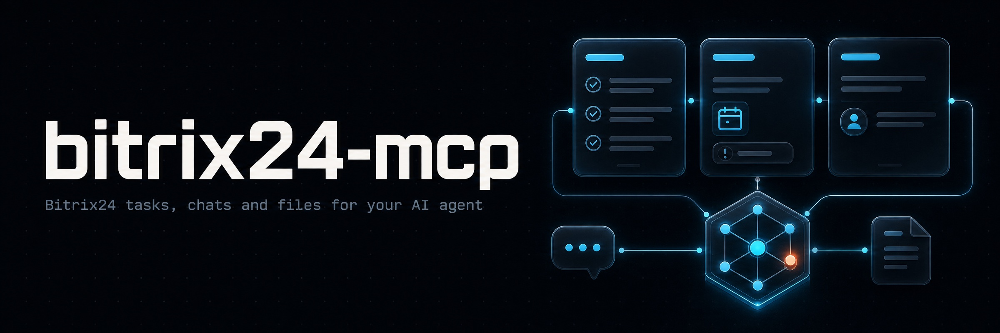

<p align="center">
  
</p>

<p align="center">
  <a href="https://github.com/adsqwui/bitrix24-mcp/actions/workflows/tests.yml"></a>
  
  
  
  
  
  <a href="LICENSE"></a>
</p>

<p align="center">
  <b>MCP-сервер, который пускает ИИ-агента в Битрикс24.</b><br>
  Задачи, чек-листы, комментарии, файлы и чаты любого портала через один входящий вебхук.
</p>

<p align="center">
  <a href="#быстрый-старт">Быстрый старт</a> ·
  <a href="#установка-по-шагам">Установка</a> ·
  <a href="#подключение-к-агенту">Подключение</a> ·
  <a href="#инструменты">Инструменты</a> ·
  <a href="#безопасность">Безопасность</a>
</p>

---

## Что умеет

- **Задачи целиком.** Поиск с фильтрами, карточка, создание и правка, старт, завершение, отложить, делегировать, вернуть в работу, удалить.
- **Чек-листы и комментарии.** Добавить, отметить, переименовать, переставить пункты. Прочитать и написать комментарий, в том числе с файлами.
- **Файлы.** Загрузить на Диск, прикрепить к задаче, скачать на сервер или получить в base64.
- **Чаты.** Найти чат по названию, прочитать историю, отправить сообщение или файл.
- **Любой портал.** Облачный (`*.bitrix24.ru`, `.kz`, `.com` и другие) или коробочный, в том числе с портом. Портал и пользователь берутся из адреса вебхука.
- **Осторожность по умолчанию.** Сервер стартует в режиме только чтения, у каждого изменения есть `dry_run`, а вебхук не попадает ни в ответы, ни в журнал.
- **Два режима.** stdio, когда агент запускает сервер сам, и Streamable HTTP с Bearer-токеном.

## Быстрый старт

```bash
git clone https://github.com/adsqwui/bitrix24-mcp.git ~/bitrix24-mcp
```

```bash
cd ~/bitrix24-mcp && ./install.sh
```

Скрипт поставит зависимости, спросит адрес вебхука, проверит его на портале и напечатает, как подключить сервер к агенту.

## Установка по шагам

### Что нужно

| | |
|---|---|
| Система | Linux или macOS |
| Битрикс24 | облачный или коробочный портал с доступом по HTTPS |
| Права | создавать входящие вебхуки (обычно есть у любого сотрудника, иначе попросите администратора) |

Python ставить не нужно: скрипт поставит [uv](https://github.com/astral-sh/uv), а тот скачает Python 3.12 в папку проекта.

### 1. Создайте входящий вебхук

1. В Битрикс24 откройте **Разработчикам → Другое → Входящий вебхук**.
2. Отметьте права: `task` (задачи), `user` (пользователи), `disk` (Диск), `im` (чаты).
3. Сохраните и скопируйте адрес вида `https://ваш-портал.bitrix24.ru/rest/15/abc123xyz/`.

Сервер будет работать от имени того, кто создал вебхук, и с его правами. Если нужен отдельный «робот», заведите для него сотрудника и создайте вебхук под ним.

### 2. Запустите установку

```bash
git clone https://github.com/adsqwui/bitrix24-mcp.git ~/bitrix24-mcp
```

```bash
cd ~/bitrix24-mcp && ./install.sh
```

Что произойдёт:

1. **Зависимости.** Ставятся uv, Python 3.12 и пакет в `.venv`. В системе ничего не меняется.
2. **Вебхук.** Скрипт спросит адрес (ввод скрыт) и сделает пробный запрос: узнает, чей это вебхук, и найдёт вашу папку на Диске для загрузки файлов. Это только чтение, в портале ничего не меняется.
3. **Режим записи.** Скрипт спросит, разрешить ли изменения. По умолчанию сервер остаётся в режиме только чтения.
4. **Токен.** Для HTTP-режима генерируется случайный `MCP_BEARER_TOKEN`.
5. **Автозапуск.** На Linux с systemd скрипт предложит поставить службу `bitrix24-mcp`.
6. **Итог.** В конце печатаются готовые настройки для stdio и HTTP.

Все настройки хранятся в `.env` с правами `600`. Повторный запуск `./install.sh` сохраняет уже заданные значения и позволяет сменить вебхук или режим записи.

### Обновление

```bash
cd ~/bitrix24-mcp && git pull && ./install.sh
```

Установщик переустановит пакет и предложит оставить текущий вебхук. Если стоит служба, перезапустите её: `sudo systemctl restart bitrix24-mcp`.

## Подключение к агенту

### stdio

Агент сам запускает сервер на той же машине. Пример для клиентов с конфигом в стиле Claude Desktop или Cursor:

```json
{
  "mcpServers": {
    "bitrix24": {
      "command": "/home/user/bitrix24-mcp/.venv/bin/bitrix-mcp",
      "args": ["--transport", "stdio", "--env-file", "/home/user/bitrix24-mcp/.env"]
    }
  }
}
```

Для Claude Code:

```bash
claude mcp add --scope user bitrix24 -- ~/bitrix24-mcp/.venv/bin/bitrix-mcp --transport stdio --env-file ~/bitrix24-mcp/.env
```

Вебхука в конфиге клиента нет: клиент передаёт только путь к `.env`.

### HTTP

```bash
~/bitrix24-mcp/.venv/bin/bitrix-mcp --transport http --env-file ~/bitrix24-mcp/.env
```

| | |
|---|---|
| Адрес | `http://127.0.0.1:8000/mcp` (Streamable HTTP) |
| Заголовок | `Authorization: Bearer <MCP_BEARER_TOKEN из .env>` |

Сервер проверяет токен и заголовок `Host`: без токена ответ `401`, с чужим хостом `421`. Слушать внешний адрес без токена он откажется.

Если агент обращается к серверу из облака по URL, поставьте перед ним reverse proxy с HTTPS и не открывайте порт наружу. Пример для [Caddy](https://caddyserver.com): сертификат он получит сам, а `Host` нужно подменить на локальный:

```
mcp.example.com {
    reverse_proxy 127.0.0.1:8000 {
        header_up Host 127.0.0.1:8000
    }
}
```

Запускайте один процесс на вебхук: ограничитель частоты запросов (2 в секунду, как требует Битрикс24) живёт в памяти процесса.

## Инструменты

Все ответы приходят компактным JSON. Ошибки выглядят одинаково: `{"ok": false, "error": {"code": "...", "message": "..."}}`. У каждого изменяющего инструмента есть `dry_run=true`: он проверяет параметры и показывает, что будет отправлено, ничего не меняя.

Пользователей можно указывать по id или по имени. Если имя подходит нескольким людям, сервер вернёт список кандидатов и попросит уточнить.

### Задачи

| Инструмент | Что делает |
|---|---|
| `task_list(status, role, user, creator, tag, deadline_from, deadline_to, search, limit, cursor)` | Поиск задач. `role`: все, ответственный, постановщик, наблюдатель, соисполнитель |
| `task_get(task_id)` | Карточка задачи с участниками, тегами, сроками, чек-листом и файлами |
| `task_create(title, description, creator, responsible, auditors, accomplices, deadline, tags, ...)` | Новая задача. Описание в markdown переводится в BB-код Битрикса. Возвращает возможные дубли |
| `task_update(task_id, ...)` | Изменить поля. Очистить поле можно флагами `clear_*` |
| `task_start` / `task_complete` / `task_defer` / `task_renew` | Смена статуса |
| `task_delegate(task_id, user)` | Передать задачу другому сотруднику |
| `task_delete(task_id)` | Удалить задачу |

### Чек-листы и комментарии

| Инструмент | Что делает |
|---|---|
| `checklist_get(task_id)` | Пункты по группам, с отметками |
| `checklist_add(task_id, titles)` | Добавить несколько пунктов за раз |
| `checklist_update` / `checklist_toggle` / `checklist_delete` | Переименовать, отметить, удалить пункт |
| `checklist_reorder(task_id, item_ids)` | Расставить пункты в нужном порядке |
| `comment_list(task_id, limit, cursor, include_system)` | Комментарии, без системных сообщений по умолчанию |
| `comment_add(task_id, text, files)` | Комментарий, можно с файлами с Диска |

### Файлы

| Инструмент | Что делает |
|---|---|
| `file_upload(name, path \| content_base64, folder_id)` | Загрузить файл на Диск, локальный путь только из `MCP_ALLOWED_ROOTS` |
| `task_attach_files(task_id, file_ids)` | Прикрепить файлы к задаче, не затирая уже прикреплённые |
| `file_download(file_id, output_path \| return_base64, source)` | Скачать файл с Диска или из вложения |

### Чаты

| Инструмент | Что делает |
|---|---|
| `chat_find(title)` | Найти чат по названию |
| `chat_history(dialog_id, last_n)` | Последние сообщения диалога |
| `chat_send(dialog_id, message)` | Отправить сообщение |
| `chat_send_file(dialog_id, file_id, message)` | Отправить файл с Диска |

### Справочные

| Инструмент | Что делает |
|---|---|
| `whoami()` | Чей вебхук и есть ли у него права администратора |
| `user_search(query)` | Найти сотрудника по имени, должности или id |
| `tag_list(scope)` | Теги задач |

<details>
<summary><b>Подробности поведения</b></summary>

- `task_url` в ответах ведёт на карточку задачи у владельца вебхука. Для чатов и файлов без задачи возвращается `null`.
- Постановщик и ответственный новой задачи по умолчанию равны владельцу вебхука.
- `task_complete` возвращает фактический статус: у задачи с контролем он может остаться «ждёт контроля» (4).
- Вложения в комментарии отправляются через `UF_FORUM_MESSAGE_DOC`. В новой карточке задачи портал может их не показать, об этом сервер предупреждает в ответе.
- Прикрепление файла к пункту чек-листа возвращает `CAPABILITY_UNVERIFIED`: у Битрикс24 нет документированного метода для этого.
- Сообщения в чат задачи идут через REST 3.0 (`tasks.task.chat.message.send`). В старых коробочных версиях этого метода может не быть, остальное работает на классическом REST.

</details>

## Настройки

Все переменные лежат в [`.env.example`](.env.example), установщик заполняет их сам.

| Переменная | По умолчанию | Что это |
|---|---|---|
| `B24_WEBHOOK_URL` | | Входящий вебхук, из него берутся портал и пользователь |
| `MCP_READ_ONLY` | `true` | `false` разрешает изменения в портале |
| `B24_DISK_FOLDER_ID` | находится сам | Папка Диска для `file_upload` |
| `MCP_ALLOWED_ROOTS` | `var/files` | Локальные папки для загрузки и скачивания файлов, через `:` |
| `MCP_MAX_FILE_BYTES` | `10485760` | Предельный размер файла (10 МБ) |
| `MCP_AUDIT_LOG` | `var/audit.jsonl` | Журнал вызовов |
| `MCP_HOST` / `MCP_PORT` | `127.0.0.1` / `8000` | Адрес HTTP-режима |
| `MCP_BEARER_TOKEN` | генерируется | Токен HTTP-режима, не короче 24 символов |

## Безопасность

- **Вебхук не утекает.** Его нет в ответах, журнале и текстах ошибок, в том числе в ошибках сети. Клиентам передаётся только путь к `.env`.
- **Только чтение по умолчанию.** `MCP_READ_ONLY=true` запрещает все записи в REST и сохранение скачанных файлов на диск. Это проверяется централизованно, а не в каждом инструменте.
- **Список разрешённых методов.** Сервер вызывает только заранее перечисленные методы REST, каждый помечен как чтение или запись.
- **Проверка владельца.** Перед первым запросом сервер через `profile` убеждается, что вебхук принадлежит пользователю из адреса.
- **Файлы под контролем.** Локальные пути только внутри `MCP_ALLOWED_ROOTS`, симлинки раскрываются до проверки. Скачивание идёт только с вашего портала.
- **Аудит без содержимого.** В журнал пишутся метод, тип операции, успех, код ошибки и время, без параметров, текстов и файлов.
- **HTTP закрыт.** Bearer-токен сравнивается за постоянное время, заголовок `Host` проверяется против DNS rebinding.

Если вебхук утёк, удалите его в Битрикс24 (Разработчикам → Интеграции) и запустите `./install.sh` с новым.

## Разработка

```bash
git clone https://github.com/adsqwui/bitrix24-mcp.git && cd bitrix24-mcp
```

```bash
uv venv --python 3.12 && uv pip install ".[test]" && .venv/bin/pytest -q
```

Тесты не ходят в настоящий портал. Для живой проверки на своём портале есть два скрипта:

| Скрипт | Что делает |
|---|---|
| `scripts/live_readonly.py [--task-id N] [--chat-title T] [--dialog-id chatN]` | Только чтение, режим записи принудительно выключен |
| `scripts/live_write_test.py` | Создаёт одну тестовую задачу на себя и проверяет на ней все изменения |

После правок кода переустановите пакет: `uv pip install --python .venv/bin/python --reinstall-package bitrix24-mcp .`. Editable-установку на macOS в `~/Documents` лучше не использовать: система прячет `.pth` файлы, и Python их пропускает.

```
src/bitrix_mcp/
├── server.py   # инструменты MCP, stdio и HTTP с Bearer-токеном
├── core.py     # настройки, клиент REST, лимит запросов, аудит, проверка владельца
├── tasks.py    # задачи и пользователи
└── extras.py   # чек-листы, комментарии, файлы, чаты
```

Документация REST Битрикс24: [b24restdocs](https://github.com/bitrix24/b24restdocs).

## Лицензия

[MIT](LICENSE)
